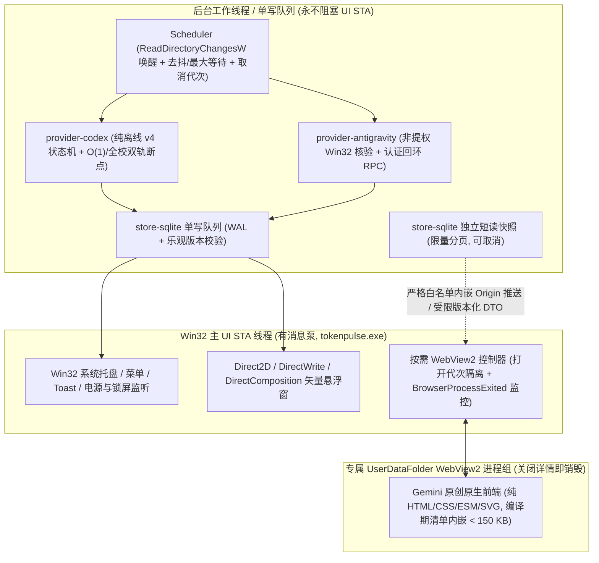

# TokenPulse — Windows 11 轻量化 AI 用量监控工具正式开发方案（v2.1 冻结版）

> **版本**：v2.1（已完成阶段一源码审计、本机实测及两轮 Codex `gpt-6.2-astra` 独立终审与裁定）  
> **上游参考基线**：`https://github.com/jeongwookie/WhereMyTokens` @ Commit `6cd99eb0b41d0ef2b306fb2553545159ac347819` (v1.26.0, MIT License)  
> **声明**：本项目为独立设计与重写的非官方开源衍生实现，与原项目 WhereMyTokens 及 OpenAI、Google 无官方关联；完整上游 MIT 版权声明见 [THIRD_PARTY_NOTICES.md](../THIRD_PARTY_NOTICES.md)。  
> **目标平台**：Windows 11 x64（经实机验证的平台；未做实机验证的旧版本操作系统暂不列入兼容承诺）  
> **首批支持平台**：OpenAI Codex、Google Antigravity  
> **协作分工**：
> - **Gemini（主控 / 产品规划 / 前端设计总负责）**：需求把关、视觉规范与 `design-tokens.json` 制定、桌面悬浮窗高保真设计稿、详细统计面板纯原生前端完整开发、原创品牌图标、最终视觉与安全验收。
> - **Codex（架构审查 / 核心引擎实现）**：架构与安全复审、Rust 核心引擎、数据解析与状态机移植、SQLite 存储层、Win32 原生集成、单元测试与基准验证脚本。

---

## 一、项目命名、仓库策略与开源合规

1. **全新独立命名与品牌**：
   - 上游源码采用 MIT License，但上游 `EULA.txt` 第 4、7 节要求衍生作品不得以易造成官方混淆的方式使用 `"WhereMyTokens"` 名称及原作者图标/品牌资产。
   - 本项目正式启用独立名称 **`TokenPulse`** 与全原创视觉图标，新建独立 GitHub 仓库（不直接 Fork 上游 Electron 仓库）。
   - 根目录保留本项目 [LICENSE](../LICENSE)（MIT）与 [THIRD_PARTY_NOTICES.md](../THIRD_PARTY_NOTICES.md)（含原项目 MIT 全文与 `Copyright (c) 2026 jeongwookie` 致谢），并在 README 与软件“关于”页中清晰声明非官方关联。

---

## 二、核心设计原则与账号安全红线

优先级从高到低不可颠倒：**1. 账号安全与平台合规 → 2. 数据准确性与软件稳定性 → 3. 极低系统资源占用 → 4. 极低额外网络与零模型消耗 → 5. 现代高审美交互界面 → 6. 后续多平台扩展能力**。

### 2.1 强制禁止行为（架构与编译期硬约束）
- 严禁发送任何提示词或调用模型探测额度（额外模型推理 Token 恒为 `0`）。
- 严禁读取、`stat`、监听、散列、刷新、修改、写回或备份任何 OAuth Token / `auth.json` / 凭据文件。
- 严禁自动切换或轮换账号。
- 严禁修改 Codex 或 Antigravity 的任何客户端文件、配置或注册表项（严格只读）。
- 严禁注入客户端进程、Hook API、读取浏览器 Cookie 或拦截/代理网络流量。
- 严禁将用户提示词、模型回答正文或原始 JSONL/RPC 正文持久化到 SQLite、日志、导出文件或 WebView2 目录中。
- 严禁内置遥测、崩溃自动上报、广告或后台静默自动更新。
- 严禁使用任何第三方中转代理。
- 严禁对无法安全、准确获取的数据进行猜测或伪造（例如缺失字段误算为 `0%` 或窗口过期自动补 `100%`），一律明确显示“暂无数据”或标注为“上次观测值 + 时间戳”。

### 2.2 V1 最终裁定：Codex 彻底零外网（选项 1）
经阶段一源码审计、本机 25 个真实 Codex JSONL（77.37 MB）实测与 Codex (`gpt-6.2-astra`) 最终裁定：
- **V1 Codex 路径彻底零外网、零凭据接触**：代码库中**不存在**任何云端 crate、feature、配置项、`CloudOptIn` 分支或 `chatgpt.com` / `rate-limit-reset-credits` 请求代码；**绝不读取、不 `stat`、不监听、不散列 `%CODEX_HOME%\auth.json`**。
- **离线数据全覆盖**：本机实测本地 JSONL 的 `payload.rate_limits` 已包含 `primary` (5h) / `secondary` (7d) 窗口、`credits` (`has_credits` / `unlimited` / `balance`) 和 `plan_type`，配合 v4 防复算状态机可纯离线完成全部核心监控。
- **窗口过期与账号归属诚实表达**：
  - 每个额度窗口清晰显示 **“本地上次观测 · 时间”** 与来源标识；当 `now >= resets_at` 时立即切换为 **“已到预计重置时间，等待新活动”**，**停止旧值低额度告警，且绝不自动补成 `100%` 满额**。
  - Credits 独立标注自身观测时间。
  - 因不读取 `auth.json`，同一个 `CODEX_HOME` 下在无可靠非凭据账号标识时，**绝不宣称“当前账号”或把多会话盲拼为同一账号余额**，诚实标注“最近会话观测（账号未确认）”，并严格按事件时间而非扫描顺序幂等写入。

### 2.3 隐私与网络责任边界声明（精确分界）
- **Codex 模块**：绝对零网络能力；解析 `CODEX_HOME` 及归档根目录时，**验证最终规范化本地路径与文件类型，拒绝 UNC 路径、映射网络卷及指向目录外的重解析点（Reparse Points）**，避免仅枚举日志就触发隐式网络 I/O。
- **应用唯一业务网络路径**：仅在用户显式启用 Antigravity 监控且端点身份安全校验通过后，访问本机明确回环地址（禁止代理、禁止重定向、禁止通配地址与明文降级）。
- **第三方边界**：不代运行中的第三方客户端（如 Antigravity IDE 或系统 WebView2 组件本身）作出“全机零出站”承诺；严格零外网模式下如无法约束系统 WebView2 运行时出站，则降级停用 WebView2 详情页而保持纯 Rust 托盘与悬浮窗运行。

---

## 三、功能需求与数据源安全清单

### 3.1 Codex 监控能力矩阵（100% 纯离线）

| 功能项 | 数据来源 | 网络行为 | 缺失 / 过期 / 未知处理 |
|---|---|---|---|
| 今日 / 近 7 天 / 近 30 天 Token（普通输入、缓存读、总输出、推理子集） | `%CODEX_HOME%\sessions`、`archived_sessions`、`session-cleanup-archive` 下本地 `.jsonl` | **无** | 仅当范围完整扫描且确无记录才显示 `0`；未完成扫描显式标注覆盖不足 |
| 缓存命中率 | 本地计算：`cache_read / (non_cached_input + cache_read)` | **无** | 总输入为 0 时显示 `—` |
| 模型使用分布与历史趋势 | 本地 JSONL + SQLite 聚合桶（同时保存 `raw_model` 与 `display_model`） | **无** | 缺模型字段标记 `Unknown (codex)` |
| API 等效费用估算 & 缓存节省 | 本地版本化定价表（UTC 生效区间 + 长上下文倍率） | **无** | 显式标注“API 等效估算（非订阅实付）”；未知模型或跨请求差量缺判档证据时标“无法精确定价”，汇总同时展示“已定价覆盖量” |
| 5 小时 / 每周额度 & 重置倒计时 | 本地 JSONL `payload.rate_limits.{primary,secondary}` | **无** | 严格校验字段类型与范围，`used_pct` 缺失为 `None`（暂无数据）；未知周期保留原态不强塞 5h/7d；`now >= resets_at` 显示“已到预计重置时间，等待新活动” |
| Credits 余额、套餐类型与服务档位 | 本地 JSONL `payload.rate_limits.credits` & `plan_type`；`.codex-global-state.json` 读取 `service_tier`（与 `plan_type` 分列） | **无** | `CreditState` 四态显式区分：`Unknown` / `None` / `Unlimited` / `Limited { balance_text: Option<String> }`（保留原始十进制文本精度） |

> 路径解析统一优先 `CODEX_HOME`，未配置时回退 `%USERPROFILE%\.codex`（并执行本地安全路径校验），兼容 Codex CLI、Codex Desktop 等共用该日志格式的客户端。

### 3.2 Antigravity 监控能力矩阵（本地回环只读 + 严格端点认证）

| 功能项 | 数据来源与硬约束 | 网络行为 | 缺失 / 离线处理 |
|---|---|---|---|
| 客户端运行状态与实例校验 | 原生 Win32 非提权进程发现：同一活进程句柄核对 `CreationTime`、`Session ID`、`Token User SID`、最终映像路径及可信安装来源（绝不凭可写目录名放行）+ `GetExtendedTcpTable` 核验监听端口确属该 PID | **无** | 区分“未运行”、“拒绝访问/权限不足”、“接口不支持”、“无法安全连接”四类明确状态；**绝不自动启动客户端** |
| 动态共享额度组 / 各模型剩余额度 & 重置倒计时 | 对通过端点认证的明确回环字面量（地址族严格匹配 `127.0.0.1` 或 `[::1]`，**拒绝 `0.0.0.0` / `::` 通配监听、代理、重定向与 HTTP 明文降级**）发送只读 Connect-RPC：优先 `RetrieveUserQuotaSummary`，仅在明确不支持或合法空组时降级 `GetUserStatus` | 仅已认证本机回环（客户端侧不直接外联，注：服务端可能间接同步云端，须限频） | 未运行或无法安全连接时，展示 SQLite 中同一实例的**上一次有效快照 + 观测时间**；完全动态解析组名与模型，零硬编码 |
| 历史额度变化趋势 | 每次有效 RPC 快照按可信作用域 + 稳定组/桶 ID 落地 SQLite `quota_observation`（仅凭标签或顺序变化时不强行拼接历史曲线） | **无** | 结构损坏、超限或截断的响应绝不发布为完整新快照 |
| 额外付费额度 / 余额 | 上游未提供安全可靠本地数据源，严禁读 Google OAuth / `state.vscdb` | **无** | 固定显示“暂无数据（无安全本地数据源）” |
| 对话正文与完整轨迹 | **严禁调用含对话正文的 `GetCascadeTrajectory`**；V1 亦不为了实例排序调用轨迹枚举接口 | — | V1 专注 Antigravity 动态额度组、重置倒计时、状态与额度趋势 |

- **Antigravity 认证、多实例与调度约束**：
  - **认证先于发送 CSRF**：发送任何携带 `--csrf_token` 的探活或业务请求前，必须在同一连接上完成对端安全校验（正常证书链及服务身份，或由独立可信渠道取得的实例证书/公钥固定值；**绝不把首次回环握手或 `rejectUnauthorized: false` 当作信任根**）。阶段二前置非提权探针将实测 Antigravity 本机 TLS 材料可用性；若目标服务仅支持明文或无法提供可信验证材料，则停留在不可用/缓存态并第一时间报告用户决策，绝不静默降级发令牌。
  - **多实例选择**：单一已验证实例自动选中；多候选实例时在 UI 提供脱敏选择器（不能证明同账号绝不合并/相加），失联时仅回退当前所选实例的历史快照。
  - **轮询与取消控制**：独立总开关（首次说明并由用户启用）；默认刷新间隔 **90 秒**（可配 60~300 秒），失败/未运行指数退避至 300 秒；每轮发现与请求设总截止时间（≤ 5 秒）、候选上限、单轮在途与取消代次；锁屏、休眠、暂停监控、实例变化或关闭开关时**立即取消在途请求并丢弃迟到响应**；认证失败（401/403）严禁换协议重试。

### 3.3 通用功能需求
- Windows 11 原生系统托盘（状态图标、低额度徽标、左键呼出悬浮窗/详情、右键菜单：手动刷新、开关悬浮窗、打开详情、暂停监控、设置、退出）。
- 桌面悬浮窗（自定义透明度、置顶、边缘吸附、拖动、缩放、整窗点击穿透及托盘一键解锁、多显示器与负坐标位置记忆、Per-Monitor DPI Aware V2）。
- 详细统计面板（按需打开、关闭即释放资源）。
- 低额度原生 Toast 通知（可按平台/窗口配置阈值，内置静默冷却，过期窗口停止告警）。
- 可选开机自启动（当前用户 `HKCU\Software\Microsoft\Windows\CurrentVersion\Run`）。
- 深色（Obsidian Slate）/ 浅色（Porcelain Frost）主题、简体中文 / 英文实时切换。
- 本地历史数据导出（JSON / CSV，仅聚合与脱敏统计，导出对话框与写盘全部留在原生 Rust 侧）。

---

## 四、总体技术架构与前端设计方案（美观 × 性能双优）

### 4.1 混合三态架构与线程/生命周期模型

采用 **单进程 Rust 核心 + Win32 原生托盘 + Direct2D/DirectWrite/DirectComposition 矢量悬浮窗 + 按需 WebView2 详情面板**。



### 4.2 悬浮窗图形合成与高 DPI 规范（修正 API 与交互细节）
- **主渲染路径**：无边框窗口 + `Direct3D11` / `Direct2D` / `DirectWrite` + `DirectComposition`（预乘 Alpha 表面），使用 **DirectComposition Visual Opacity** 实现 30%~100% 平滑透明度控制（不使用 `SetWindowDisplayAffinity`）。
- **明确回退路径**：若阶段二探针在特定显卡驱动下发现 DirectComposition 合成异常，则显式回退至“纯不透明标准圆角窗口”或“独立声明的 `WS_EX_LAYERED` + `SetLayeredWindowAttributes` 回退路径”，绝不混用不兼容 API。
- **跨进程命中与穿透**：独立设计“常规交互模式”、“整窗点击穿透模式（配合托盘/热键一键解锁）”，并对圆角外透明区域、拖拽标题区和阴影区的跨进程鼠标命中在 Windows 11 实机验证。
- **高 DPI 与设备恢复**：启用 **Per-Monitor DPI Aware V2**，全部布局基于 DIP，响应 `WM_DPICHANGED` 重建表面、阴影与命中区，覆盖多屏混合缩放、负坐标显示器、拔屏与 D3D 设备丢失恢复。
- **零帧空转机制**：严禁 60 fps 渲染循环！仅在数据快照变更、悬停/拖拽、主题/DPI 切换、或**悬浮窗可见且倒计时显示文本实际变化/到期**时提交一次重绘，以应用内部 `Present/Commit` 帧计数验证空闲 0 帧。

### 4.3 WebView2 生命周期与安全信任边界
1. **COM STA 生命周期管理**：
   - 首选复用主 Win32 UI STA 线程创建、运行与关闭 WebView2，后台线程只交付只读 DTO、永不同步等待 STA 回调。
   - 维护单调递增的 **打开代次 (`open_generation`)**：快速反复开关或异步创建期间关闭时，迟到回调因代次不匹配立即丢弃并释放控制器。
   - 关闭详情窗口按严格顺序解绑事件 → 关闭 Controller → 释放 WebView 与 Environment，并监听基于本应用**独立专属 `UserDataFolder`**（位于 `%LOCALAPPDATA%\TokenPulse\webview2\`）的 `BrowserProcessExited` 确认专属浏览器进程退出，**绝不按进程名强杀系统其他应用共享的进程**。
   - 阶段二先做反复开关/创建中关闭/崩溃恢复探针；仅当同进程释放实测无法达标时，再切换为同一 EXE 的短命 `--detail-host` 子进程宿主。
2. **严格零信任安全边界**：
   - 前端与宿主通信**优先采用宿主单向推送聚合 DTO**；确需按时间范围/分页查询时，仅向固定编译期内嵌 Origin（如 `https://app.tokenpulse.local` 虚拟映射）的**顶层文档**开放版本化消息协议，逐条校验消息来源、类型、时间区间上限、分页上限、负载体积与调用频率。
   - 静态资源仅按编译期精确文件清单白名单映射，禁止路径遍历；注入严格 CSP（`default-src 'self'; script-src 'self'; style-src 'self'; img-src 'self' data:; connect-src 'none'; object-src 'none'; frame-ancestors 'none'`）。
   - 全面拦截非预期导航、子框架、新窗口、文件下载、外部协议与浏览器权限申请；所有来自日志的模型名、Antigravity 组名在前端一律按纯文本 (`textContent`) 渲染，彻底杜绝 XSS；DTO 中绝不含本地绝对路径、凭据或原始日志文本；文件导出与系统设置写盘完全留在原生 Rust 侧。

### 4.4 Gemini 前端设计专责与双端 Design Tokens
- **视觉主导权**：桌面悬浮窗视觉规范、详细统计面板 UI/交互、原创品牌与托盘图标均由 **Gemini 全权设计与实现**。
- **设计先行流程**：阶段三编码前，Gemini 先交付高保真交互式静态原型（同时呈现悬浮窗与详情面板的深浅双主题、中英双语、空态/过期态/不可用态），经用户审核通过后冻结 [`docs/design-tokens.json`](docs/design-tokens.json)（颜色、圆角、字号、间距、阴影、语义色阶），Direct2D 与 Web 前端严格共享同一套 Token。
- **零重型框架前端**：详情页纯手写原生 HTML5 + CSS Variables + 原生 ESM + 矢量 SVG/Canvas 图表，无需 Node.js 构建链，内联嵌入二进制体积 `< 150 KB`。

---

## 五、Rust Workspace 结构、接口与核心算法不变量

### 5.1 Workspace 目录结构

```text
TokenPulse/
├── Cargo.toml                        # Workspace + Release 体积优化 (lto="fat", opt-level="z", strip=true, panic="abort")
├── LICENSE                           # MIT License
├── THIRD_PARTY_NOTICES.md            # 上游 WhereMyTokens MIT 全文与致谢声明
├── README.md                         # 项目简介与跨机开发指南
├── docs/
│   ├── DEVELOPMENT_PLAN.md           # 本 v2.1 冻结正式方案
│   ├── PHASE1_AUDIT_SUMMARY.md       # 阶段一审计结论与实测摘要
│   ├── design-tokens.json            # 阶段三冻结的双端统一 Design Tokens
│   └── security-and-privacy.md       # 面向用户的安全与隐私透明说明
├── crates/
│   ├── core-domain/                  # 零 I/O 领域模型、定价引擎、未知/过期态类型、配置 Schema
│   ├── provider-codex/               # Codex 纯离线扫描、v4 去重状态机、双轨断点校验、rate_limits/credits 解析
│   ├── provider-antigravity/         # 非提权 Win32 进程/端口核验、认证回环 Connect-RPC、动态额度组解析
│   ├── store-sqlite/                 # SQLite WAL 单写队列、四态事务提交、精确混合聚合、留存压缩、导出
│   ├── scheduler/                    # ReadDirectoryChangesW 唤醒、最大等待去抖、取消代次、电源/锁屏管理
│   ├── ui-win32/                     # Win32 托盘、菜单、Toast、自启、Direct2D/DirectComposition 高 DPI 悬浮窗
│   ├── ui-detail-web/                # UI STA WebView2 宿主、严格 Origin/CSP 安全桥接、内嵌静态资源清单
│   └── app/                          # 单一可执行入口 (单实例互斥锁、--probe / --bench 诊断模式)
├── frontend/                         # Gemini 原创详情面板与视觉原型源码 (纯 HTML/CSS/ESM/SVG)
└── tests/
    ├── fixtures/                     # 脱敏合成测试集（分叉/回绕/改名/跨卷归档/坏行/长行/时区/RPC）
    └── benchmarks/                   # Windows 11 三态内存、冷启动、零帧与隐私哨兵验收脚本
```

### 5.2 核心数据模型要点（修正未知态与归属表达）

```rust
#[derive(Debug, Clone, PartialEq, Eq)]
pub enum CreditState {
    Unknown,
    None,
    Unlimited,
    Limited { balance_text: Option<String> }, // 保留十进制原始文本，balance 可单独未知
}

#[derive(Debug, Clone, Copy, PartialEq, Eq)]
pub enum QuotaPeriodKind {
    FiveHour,
    Weekly,
    Unknown(Option<u64>), // 保留原始未知分钟数，绝不强塞 5h/7d
}

#[derive(Debug, Clone, Copy, PartialEq, Eq)]
pub enum QuotaSourceKind {
    LocalLogSession,   // 离线日志（未确认账号归属）
    LocalRpcVerified,  // 已认证 Antigravity 回环 RPC
    CachedSnapshot,    // 离线持久化快照
}

#[derive(Debug, Clone)]
pub struct QuotaObservation {
    pub provider: ProviderId,
    pub scope_id: String,            // 可信实例/会话作用域，无凭据时不伪称“当前账号”
    pub account_confirmed: bool,
    pub target_id: String,
    pub target_label: String,
    pub period_kind: QuotaPeriodKind,
    pub used_pct: Option<f64>,       // None = 暂无数据
    pub resets_at_ms: Option<i64>,
    pub event_time_ms: Option<i64>,  // 事件真实时间（区分于 ingested_at_ms）
    pub event_time_trusted: bool,
    pub ingested_at_ms: i64,
    pub source_kind: QuotaSourceKind,
}
```

### 5.3 六大核心工程不变量（逐项修复审计隐患）

1. **Codex v4 防复算状态机 + 严格分行边界**：
   - 精准移植 `accounting.ts` v4：分叉会话继承前缀仅建基线、双累积视图（`token_usage_record` vs `event_msg/token_count`）offset 对齐、计数器回绕递增 `segment`、128 项近期观察窗口、持久身份别名。
   - **严格分行**：共享读取打开（`FILE_SHARE_READ | FILE_SHARE_WRITE | FILE_SHARE_DELETE`），先固定本批读取上界，**持久字节断点仅推进到完整 LF 之后**；未以换行结尾的尾部片段原样留待下次追加；已换行但 JSON 损坏的行记录脱敏错误与覆盖缺口、绝不记录正文；设定单行最大安全长度与流式跳过恢复规则。
2. **常规 O(1) + 后台全校双轨断点机制（修复 `< 4 KiB` 短文件缺陷）**：
   - 同一打开文件句柄获取文件标识（卷序列号 + 文件 ID + 创建时间作为辅助线索）并读取已提交前缀内窗口。
   - 头尾哈希窗口**严格限定在旧已提交前缀 `[0, committed_offset)` 范围内并持久化窗口实际字节长度**（当 `committed_offset < 4096` 时窗口长度即 `committed_offset`，彻底杜绝短文件追加误判替换）。
   - 首次扫描同时持久化分块/前缀可复核摘要；日常追加走 O(1) 校验（旧前缀逻辑校验读取 `≤ 8 KiB`），后台按确定周期轮转执行 O(n) 完整前缀复核，发现中段覆写立即触发安全重建。
3. **路径、物理文件、逻辑会话与执行分离（归档移动与监听恢复）**：
   - 稳定 `source_id` 与物理路径别名分离。同卷已验证改名（`sessions` → `archived_sessions`）仅更新路径别名不重算；跨卷“复制后删除”通过可信会话/执行身份别名核对防重复计费；路径消失绝不直接级联删除逻辑历史。
   - `ReadDirectoryChangesW` 仅作为低成本唤醒提示，去抖同时设**最大等待上限**（例如 300 ms 静默 / 1500 ms 强制刷新，防持续写入饿死）；启动、队列溢出或唤醒恢复时执行三根目录增量对账。
4. **SQLite WAL 单写队列 + 可证明的四态重建提交**：
   - 每源最多允许一个在途扫描；SQLite 由**单一专用写线程队列**串行提交，提交时强制校验 `(expected_generation, expected_offset, expected_version)`，不匹配直接丢弃重算，防止旧批次倒推断点。
   - 明细、身份别名、小时/天/月桶差量、额度/Credits 观测、`resume_state` 与新断点在**同一事务**内原子提交；全部文件扫描与网络 I/O 均在事务外执行。
   - **重建删除严格证明**：重建过程单独记录“本批扫描完整见到的逻辑执行集合”及“完整无中断覆盖证明”；**仅当扫描完整无中断且无覆盖缺口时**才与旧明细集做差确定 `Removed` 并扣桶；预算截断、坏行或取消中断绝不触发删除！
5. **“整桶 + 边缘明细”UTC 精确聚合与定价证据**：
   - 全库统一存储 **UTC 毫秒时间戳** 与半开区间 `[from_ms, to_ms)`；“今日 / 近 7 天 / 近 30 天”先按明确展示时区计算本地日历边界再转 UTC（正确覆盖 23/25 小时夏令时日及半小时时区）。
   - 单次读快照事务内，中间取**完全包含于区间内**的 `usage_bucket`，首尾取与之严格互斥不重叠的 `usage_entry` 边缘明细（同桶区间仅查一次明细不重复计算），全部在 SQL 侧分组分页并支持取消。
   - 明细留存期必须覆盖全部承诺的精确查询窗口；超出留存边界的历史查询显式返回当前可用粒度（如按天/按月），绝不静默补零。
   - 定价引擎以可信单请求输入判定 `> 272,000` 长上下文倍率；v4 仅给出跨请求累计差量而缺少单请求证据时，标记“无法精确定价”并在汇总中展示已定价覆盖率；存储 `price_rule_id` 与定点/统一舍入金额，费率修订支持事务重算并保持明细与桶严格一致。

---

## 六、性能验收指标与统一测量口径

在固定 **Windows 11 x64 实机 + 固定 Release 构建 + 固定脱敏数据集** 上，统一统计**整棵进程树 Private Working Set（私有工作集）与 Private Bytes（私有提交）**，所有核心延迟与内存均以 **P95** 为最终判退依据（同时记录 P50 与峰值，并与上游 WhereMyTokens 同机对比）：

| 验收维度 | 发行硬线目标 | 阶段二探针参考 | 精确测量与判据口径 |
|---|---|---|---|
| 托盘常驻内存 | **< 20 MB**（挑战 < 10 MB） | < 15 MB | 稳态空闲 5 分钟 P95 私有工作集；WebView2 进程数 = `0` |
| 悬浮窗开启内存 | **< 40 MB**（挑战 < 25 MB） | < 30 MB | 仅开 Direct2D 悬浮窗稳态 P95 私有工作集；WebView2 进程数 = `0` |
| 详情面板内存与双路径回落 | 开启 **< 130 MB**；关闭后 5 秒内回落至对应基线（托盘态 `< 20 MB` / 悬浮窗态 `< 40 MB`） | 连续开关 10 次 Private Bytes 无单调泄露 | 分别测 **托盘→详情→托盘** 与 **悬浮窗→详情→悬浮窗**，并校验专属 `UserDataFolder` 浏览器进程退出 |
| 空闲 CPU 占用 | **< 0.1%** | — | 稳态空闲 10 分钟平均 CPU 占比 |
| 空闲 GPU / 渲染帧 | **0 提交帧 / 10 分钟**（GPU ≈ 0%） | — | 以应用内部 `Present/Commit` 计数验证零帧空转，任务管理器 GPU 读数作旁证；倒计时更新态单测 |
| 便携版程序体积 | **< 10 MB** | — | Release 单 EXE 或便携 ZIP（复用 Win11 系统预装 WebView2） |
| 冷启动时间 | **< 1.0 s**（P95） | — | 双击启动到托盘图标可交互（大库历史补扫后台异步进行） |
| 常规增量校验 I/O | **旧前缀逻辑校验 ≤ 8 KiB / 次** | — | 区分“旧前缀校验逻辑读取”与“新增行本身字节数”，另在标准短行夹具下验证单次总读取 ≤ 16 KiB |
| 额外模型 Token | **0** | **0** | 全生命周期零模型调用 |
| 隐私与网络红线 | **Codex 零出站 / 零 `auth.json` 访问** | — | 文件句柄轨迹 + 本应用及专属子进程 DNS/TCP/UDP 审计 + 隐私哨兵扫描 |

---

## 七、分阶段开发计划、分工与 Gate 验收标准

| 阶段 | 核心交付物（已前置全部高风险探针） | 协作分工 | Hard Gate 验收标准 |
|---|---|---|---|
| **阶段二：工具链 + 高风险探针 + 核心数据层** | ① 安装 Rust/MSVC 工具链；② **前置三项小探针**：Antigravity 非提权 Win32 进程/TLS 认证可行性探针、UI STA 专属 WebView2 反复开关回收与缺 Runtime 降级探针、DirectComposition 悬浮窗最小探针；③ 实现 `core-domain`、`provider-codex`（v4 + 离线 `rate_limits`/`credits` + 双轨断点）、`store-sqlite`（单写队列 + 四态重建 + 混合聚合）、`scheduler` | **Codex**：探针代码、核心 crates 与全面单测；**Gemini**：探针结论裁决、真实本机 77 MB 日志核验、DTO 契约冻结 | ① 合成夹具（分叉/回绕/短文件增长/中段覆写/同卷改名/跨卷复制删/23h&25h 夏令时/两次 rebuild/中断重建）逐项全量比对 100% 吻合；② 探针数据通过门槛并明确 Antigravity TLS 验证结果；③ 零 `auth.json` 打开、零外网出站 |
| **阶段三：Gemini 视觉定稿 + 完整桌面界面 MVP** | ① **Gemini 先交付高保真交互设计稿（悬浮窗 + 详情页、深浅双色、中英双语、空/过期/不可用态）与原创图标，用户确认后冻结 `design-tokens.json`**；② 实现完整 Win32 托盘/菜单/Toast/自启与 Direct2D 悬浮窗（含透明穿透与混合 DPI）；③ Gemini 开发纯原生详情前端并接入严格白名单/CSP 桥接 | **Gemini**：视觉设计、图标、详情前端实现与逐项视觉验收；**Codex**：Direct2D 渲染层、Win32 消息与安全桥接 | ① 100%~200% 混合多屏、负坐标、透明角跨进程命中实测通过；② WebView2 安全拒绝用例全过（非法 Origin、外链导航、新窗、XSS 模型名、超限查询均被拦截）；③ 视觉审美经用户亲自验收通过 |
| **阶段四：Antigravity 集成 + 安全与性能终审** | ① 按阶段二探针结论正式实现 `provider-antigravity`（多实例脱敏选择、取消代次、离线快照回退、锁屏/休眠暂停）；② **隐私哨兵自动化验收**（核查 DB/WAL/日志/导出/WebView2 目录零提示词零凭据）；③ 全量网络审计、故障恢复与 7×24 稳定性测试、与上游 WhereMyTokens 同机性能对比报告 | **Codex**：Antigravity 实现与自动化压测/哨兵/基准脚本；**Gemini + Codex 交叉终审** | ① 全部第六节 P95 硬指标达标；② 隐私哨兵 0 命中；③ 客户端重启、429/失联、坏行、日志截断、锁屏唤醒全过 |
| **阶段五：独立品牌打包与发布** | ① Windows 11 x64 便携版构建脚本；② 干净 Win11 实机验收（无提权、无静默下载、WebView2 缺失优雅降级、托盘可用）；③ 完善 `README.md`、`docs/security-and-privacy.md`、`THIRD_PARTY_NOTICES.md` 与 Release 清单 | **Codex**：Release 打包与干净机验证脚本；**Gemini**：文档、展示图与终审发布 | 便携包 `< 10 MB`；冷启动 `< 1.0 s` (P95)；合规声明与许可证零瑕疵 |

---

## 八、关键风险与应对预案

1. **Antigravity 本地 TLS 验证材料不可得或仅支持明文**：阶段二非提权探针第一时间查明实情；若无法建立不依赖盲信的可信验证，不降级泄露 CSRF，先冻结 Antigravity 不可用/缓存态并在不阻塞 Codex V1 交付的前提下与用户确认合规策略。
2. **同进程 WebView2 内存回收不彻底**：阶段二探针若发现连续 10 次开关详情页后私有提交无法回落，则立即切换为同一 EXE 的短命 `--detail-host` 子进程宿主，关闭详情窗口即退出子进程确保 OS 级 100% 回收。
3. **极端精简 Windows 11 缺失 WebView2 Runtime**：托盘与 Direct2D 悬浮窗完全不依赖 WebView2，100% 正常运作；仅点击“详细面板”时友好提示下载微软官方 WebView2 Runtime（绝不静默联网下载）。
4. **Codex 未来日志 Schema 变更**：防御性 JSON 解析，未知字段安全忽略、关键字段缺失返回 `Unknown / 暂无数据`，记录脱敏解析告警且不影响其余指标统计。

---

## 九、v2.2 社区项目调研吸收与安全过滤附注（2026-11-26）

在阶段二完成后，对比研读了开源社区 MIT 协议项目 `elviscjn-cjn/antigravity-context-viewer` 与 `ahmetdotsh/agy-context`，在严守本方案第二节全部安全红线的前提下，正式吸收以下 **4 项高价值改进**，并明确拒绝所有高风险侵入式做法：

1. **Antigravity 纯离线只读 `transcript.jsonl` 数值解析（已落地至 `crates/provider-antigravity`）**：
   - 探针 A 实测确认 Antigravity 2.35.2 本地 HTTPS 仅提供内置自签证书且无 `--csrf_token` 命令行参数；因此在线额度组 RPC 仍保持安全冻结/缓存态。
   - 吸收 `agy-context` 零侵入离线路径：直接只读扫描 `%USERPROFILE%\.gemini\antigravity\brain\<cid>\.system_generated\logs\transcript.jsonl`，流式仅反序列化 `type == "PLANNER_RESPONSE" && status == "DONE"` 的数值与模型元数据（`step_index`, `created_at`, `model`, `input_tokens`, `cache_read_tokens`, `output_tokens`），**彻底忽略 `content`/`thinking`/`tool_calls` 正文**；按实测互斥口径映射（`non_cached_input = input_tokens`, `cache_read = cache_read_tokens`, `inclusive_input = non_cached + cache_read`），复用安全本地路径校验与 O(1)/全校双轨断点，使 Antigravity 在 V1 即具备 100% 纯离线、零外网、零凭据的精确 Token、模型分布与缓存命中率监控能力。
2. **双维缓存命中率（最近一轮 vs 累计）**：
   - 在 `OverlaySnapshotDto` / `DashboardSnapshotDto` 与 `store-sqlite` 中新增 `latest_turn_cache_hit_ratio`，与累计 `cache_hit_ratio` 并列展示，便于实时诊断长对话缓存失效。
3. **模型额度四态细粒度分类**：
   - `QuotaWindowState` 增补 `PlanRestricted { reason }`（当前套餐无权限），与正常活跃、已耗尽/过期等待新活动、暂无数据严格区分，且受限态绝不触发低额度告警。
4. **阶段三 UI 视觉采纳**：
   - 悬浮窗支持「紧凑环形胶囊 + 展开卡片」双形态；详情面板新增 **5 档日活跃热力图**（`DailyHeatmapCellDto`，复用 UTC 整桶+边缘明细精确查询）。
5. **明确拒绝项**：严禁改写客户端 `app.asar` / CDP 挂载 / 二进制解锁 / 篡改提示词或汉化 / 劫持 CLI 启动链；严禁读取 `hub_*.json` 或 OAuth 凭据并向自签证书端点发令牌；严禁 `rejectUnauthorized: false`、明文降级或联网拉取外部定价表。

